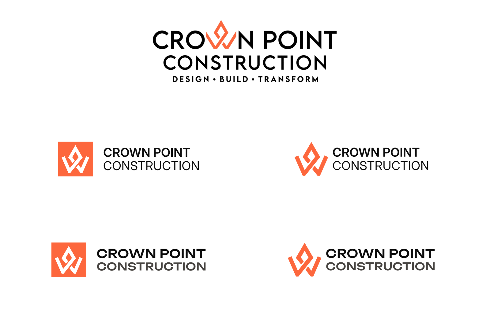
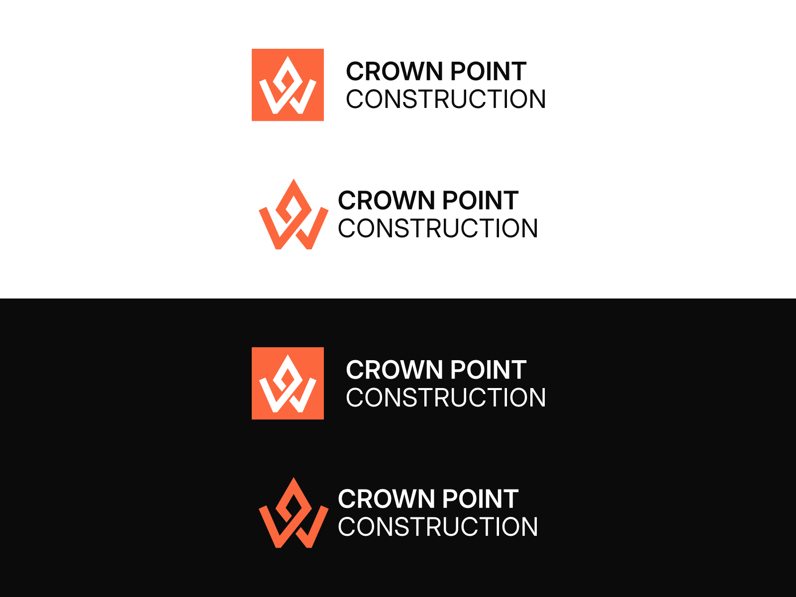
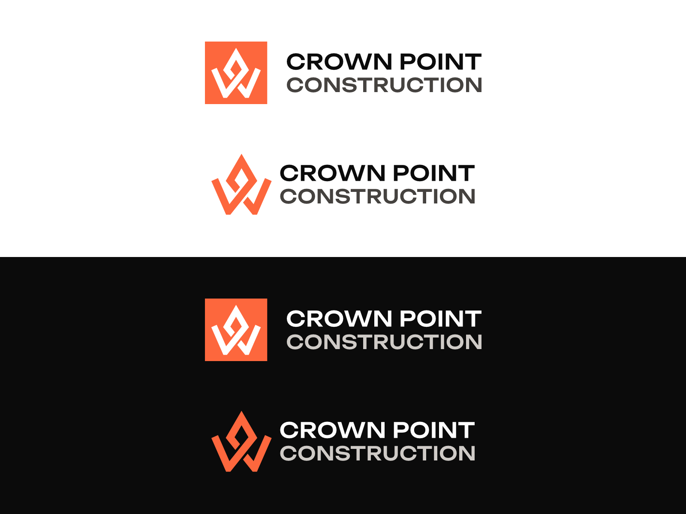

# Crown Point Construction: Logo Proposal

Two logo directions for Crown Point Construction, prepared by ImageWorks Creative.

Both options keep what already belongs to the brand (the orange crown and the name) and fix two problems with the current logo:

- **Readability.** In the current logo the crown stands in for the "W", so the name can read as "CRO_N". The new versions spell out **CROWN POINT** in full.
- **Fit.** The current logo is stacked in three lines, so it gets very small in a website header. Both new versions are horizontal, and both include a stand-alone symbol for favicons, social profiles, signage and merchandise.

The two options differ in typography. Each one comes with two symbols: the crown inside an orange **badge**, or the orange **crown** on its own.



*Top: current logo. Middle: Option 1. Bottom: Option 2. Badge on the left, crown on the right.*

---

## Option 1: Clean

A clean, neutral sans serif. CROWN POINT in semibold and CONSTRUCTION in regular, both the same size and color.



- Simple and modern, easy to read at any size.
- The weight change alone separates the name from "Construction".

## Option 2: Bold

A wide, geometric typeface with more personality. Both lines share the same typeface and weight; CONSTRUCTION is slightly smaller, so both lines end at the same width, and a touch lighter in color.



- Distinctive and strong, with a "built" feel that suits a construction company.
- The two lines form a solid block next to the symbol.

---

## Typography

| | CROWN POINT | CONSTRUCTION |
|---|---|---|
| Option 1 · Clean | Inter SemiBold, all caps | Inter Regular, all caps, same size |
| Option 2 · Bold | Unbounded Medium, all caps | Unbounded Medium, all caps, slightly smaller |

## Colors

| Color | HEX | Use |
|---|---|---|
| Crown Orange | `#FD673D` | Crown and badge |
| Ink Black | `#0B0B0B` | Name on light backgrounds |
| White | `#FFFFFF` | Name on dark backgrounds, crown inside the badge |
| Charcoal | `#45423F` | Option 2: "CONSTRUCTION" on light backgrounds |
| Soft White | `#CFCBC7` | Option 2: "CONSTRUCTION" on dark backgrounds |

## Files

Each option includes the logo with the badge and with the crown, each in a light version (for white or light backgrounds) and a dark version (for black or dark backgrounds). The symbols are shared by both options. All files have a transparent background.

```
option-1-clean/
  svg/   vector files (web and design use)
  pdf/   vector files (print and Adobe Illustrator)
  png/   high-resolution images
option-2-bold/
  svg/  pdf/  png/
symbols/    the badge and the crown on their own
previews/   presentation boards
reference/  current logo, for comparison
```

You can also open `index.html` in a browser to see both options in context.
